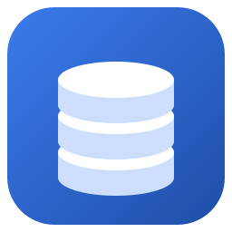

# Fosta Studio

[](https://github.com/caothanhphatit/fosta-dbclient/actions/workflows/ci.yml) [](LICENSE) [](https://github.com/caothanhphatit/fosta-dbclient/releases/latest)

**English** · [Tiếng Việt](README.vi.md)

A small, fast database client for **11 engines**: MariaDB, MySQL, SQL Server, MongoDB, PostgreSQL, SQLite, Redis, Elasticsearch,
OpenSearch, ClickHouse and Oracle. A desktop app for Windows, or a web edition in Docker. Free and open source (GPL-3.0).

**[Download for Windows](https://github.com/caothanhphatit/fosta-dbclient/releases/latest)** ·
[Website](https://dbcl.fosta.app) · [Changelog](CHANGELOG.md)

## Features

- **11 engines, one interface**: a tree, a typed data grid with inline edits, query tabs, a design view and ER diagrams, plus views
  made for each engine (Redis key browser, Elasticsearch Dev Tools and ES|QL, ClickHouse mutations, Oracle PL/SQL).
- **Workspaces** per project or environment, each with its own connections, tabs and **commands** such as
  `kubectl port-forward`, restarted when they drop.
- **SSH tunnels and TLS** on every network engine: key, password or agent, a jump host, host key checks, your own CA, client
  certificates or a pinned certificate.
- **Commands for connections**: a connection can use a workspace command, started with the workspace or when it connects.
- **Safe by default**: every statement is checked against the workspace's rules (Open, Guarded, Read-only or Custom). Production
  workspaces start read-only, enforced by the database too, and a save never overwrites a row someone else changed.
- **Query editor** with column-aware completion, a formatter, streaming results with a real Stop, transactions and per-tab history.
- **Import and export**: CSV, TSV and JSON in; CSV, CSV for Excel, JSON, SQL `INSERT` and Markdown out.
- **AI agent** (`Ctrl+Shift+A`) with your own provider and key (Fosta, OpenAI, Gemini, Claude, Ollama…). It knows your schema,
  writes and fixes queries, and reads sample rows only if you allow it.
- **MCP server** for Claude Code, Claude Desktop, Cursor, VS Code and Zed: they use your saved connections without seeing passwords,
  only in the workspaces you allow, and every write waits for your approval. Off by default; see [docs/mcp.md](docs/mcp.md).
- Light and dark themes, settings in one portable JSON file, passwords in Windows Credential Manager.

All the details: [docs/features.md](docs/features.md).

## Getting started

### Windows

Download the installer or the portable `.exe` from the [latest release](https://github.com/caothanhphatit/fosta-dbclient/releases/latest)
and run it. The binaries are not code-signed yet, so Windows SmartScreen may warn you: choose *More info* → *Run anyway*. The installed app updates itself
(downloaded in the background, installed when you quit); the portable one shows when a new release is out.

### Run with Docker (web edition)

```sh
docker run -d --name fosta-studio -p 127.0.0.1:8080:8080 -v fosta-studio-data:/data ghcr.io/caothanhphatit/fosta-studio
docker logs fosta-studio
```

Open the sign-in address printed in the log (`http://localhost:8080/?token=…`). For databases on your own machine, use
`host.docker.internal` instead of `localhost`. Settings, upgrades and HTTPS: [docs/web-edition.md](docs/web-edition.md).

### Oracle

Oracle needs Oracle Instant Client. The app offers to download it the first time you connect
([details](docs/engines/oracle.md)).

### From source

Node 20+ and Rust 1.88+:

```sh
npm install
npm run tauri dev
```

Building, tests and test databases: [CONTRIBUTING.md](CONTRIBUTING.md).

## Keyboard shortcuts

| Keys            | Action                                 |
| --------------- | -------------------------------------- |
| Ctrl+1 … 9      | Switch workspace                       |
| Ctrl+N / Ctrl+T | New connection / new query             |
| Ctrl+Enter / F9 | Run SQL (the selection, or everything) |
| Enter / F2      | Edit the selected cell                 |
| Shift+Enter     | Open the cell in the editor            |
| Ctrl+S / F5     | Save grid changes / reload the table   |
| Ctrl+Shift+A    | AI agent                               |

## More

- [Security and privacy](docs/security.md): what is stored where, what is sent, how read-only works.
- [MCP server](docs/mcp.md): set up AI clients and what they can see and do.
- [ROADMAP.md](ROADMAP.md): what comes next.
- [ARCHITECTURE.md](ARCHITECTURE.md): how it is built.
- [docs/engines](docs/engines): notes per engine, SSH and TLS.

## License

[GPL-3.0](LICENSE). Contributions are accepted under the [CLA](CLA.md), which also lets the maintainer offer commercial licenses.
Fosta, the AI agent's default provider, is a separate service by the same author; it is optional, and any other provider works the
same way.
